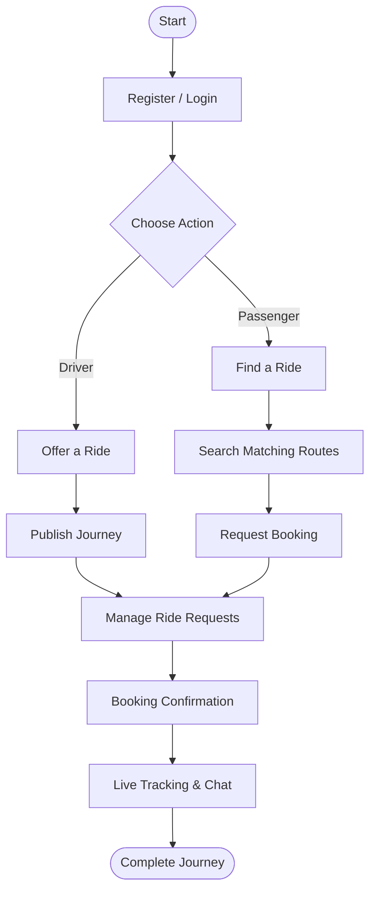

# 🚗 WayShare – Smart Vehicle Pooling System

<div align="center">


<br/>


<br/><br/>

**A smarter way to travel together, share rides, and reduce transportation costs.**

</div>

---

## 🌟 About WayShare

**WayShare** is a Smart Vehicle Pooling System built using the MERN Stack. It connects drivers and passengers travelling along similar routes, allowing them to share rides, split travel expenses, and track journeys in real time.

The platform allows users to both offer rides and book available seats, making transportation more affordable, convenient, and efficient.

## ✨ Features

<table>
<tr>
<td width="50%">

### 🔐 Authentication
- Secure user registration
- Login and authentication
- User profile management

### 🚘 Ride Management
- Offer a ride
- Find available rides
- Manage seat availability
- Booking requests

### 🗺️ Smart Maps
- Interactive maps
- Pickup and destination markers
- Route visualization
- Location-based ride search

</td>
<td width="50%">

### 📡 Live Tracking
- Real-time location updates
- Active journey tracking
- Driver location sharing

### 💰 Smart Fare Sharing
- Distance-based fare calculation
- Shared journey expenses
- Joining ongoing rides

### 💬 Communication
- Driver-passenger chat
- Individual passenger chat
- Booking notifications

</td>
</tr>
</table>

## 🛠️ Tech Stack

<div align="center">


</div>

| Technology | Purpose |
|---|---|
| React.js | Frontend development |
| Node.js | Backend runtime |
| Express.js | REST API development |
| MongoDB | Database |
| Mongoose | Database modeling |
| Socket.IO | Real-time communication |
| React Leaflet | Interactive maps |
| Leaflet | Map rendering |
| JWT | Authentication |
| bcrypt | Password hashing |

## 💡 How WayShare Works

<div align="center">



</div>

## 💰 Smart Fare Sharing

WayShare aims to make ride-sharing expenses fair through distance-based fare distribution.

**Example:**

| Details | Value |
|---|---:|
| Total Journey Fare | ₹100 |
| Passenger Seats | 4 |
| Cost Per Passenger (Full Occupancy) | ₹25 |

Passengers can also join an ongoing ride from suitable pickup points along the driver's route. Their share is calculated according to their travelled distance and shared journey segments.

## 🗺️ Mapping & Real-Time Tracking

- Open-source map integration.
- Interactive route visualization.
- Pickup and drop-off locations.
- Location updates through Socket.IO.
- Route-based passenger pickup.

## 🚀 Installation

### 1. Clone Repository

```bash
git clone https://github.com/Anish7307/WayShare.git
cd WayShare
```

### 2. Backend Setup

```bash
cd Backend
npm install
```

Create a `.env` file:

```env
PORT=5005
MONGO_URI=your_mongodb_connection_string
JWT_SECRET=your_jwt_secret
```

Start backend:

```bash
npm run dev
```

### 3. Frontend Setup

Open another terminal:

```bash
cd Frontend
npm install
npm run dev
```

Open the local URL provided by Vite.

## 📁 Project Structure

```text
WayShare/
│
├── Backend/
│   ├── config/
│   ├── controllers/
│   ├── middleware/
│   ├── models/
│   ├── routes/
│   └── server.js
│
├── Frontend/
│   ├── public/
│   └── src/
│       ├── assets/
│       ├── components/
│       ├── context/
│       ├── pages/
│       └── App.jsx
│
└── README.md
```

## 🔮 Future Improvements

- AI-powered ride matching.
- Advanced route optimization.
- Online payment integration.
- Driver and passenger ratings.
- Ride history and analytics.
- Enhanced identity verification.

## 👨‍💻 Developer

<div align="center">

### Anish Tiwari

**B.Tech – Computer Science & Engineering**

<a href="https://github.com/Anish7307">

</a>

</div>

---

<div align="center">

### 🚗 WayShare

**Share Your Ride • Split Your Cost • Travel Together**


</div>
